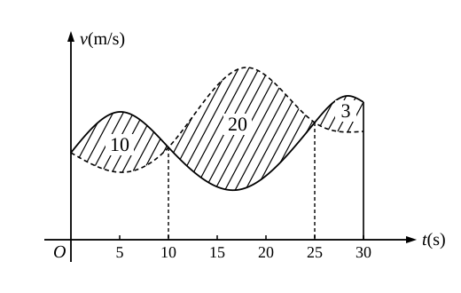

# 2017年全国硕士研究生招生考试数学二试题

---

### 一、选择题（本题共 8 小题，每小题 4 分，满分 32 分。每小题给出的四个选项中，只有一项符合题目要求）

**(1)** 若函数 $f(x) = \begin{cases} \dfrac{1 - \cos\sqrt{x}}{ax}, & x > 0, \\ b, & x \leqslant 0 \end{cases}$ 在 $x = 0$ 处连续，则（　　）  
- (A) $ab = \dfrac{1}{2}$.  
- (B) $ab = -\dfrac{1}{2}$.  
- (C) $ab = 0$.  
- (D) $ab = 2$.

**(2)** 设二阶可导函数 $f(x)$ 满足 $f(1) = f(-1) = 1$，$f(0) = -1$ 且 $f''(x) > 0$，则（　　）  
- (A) $\displaystyle\int_{-1}^1 f(x)\,\mathrm{d}x > 0$.  
- (B) $\displaystyle\int_{-1}^1 f(x)\,\mathrm{d}x < 0$.  
- (C) $\displaystyle\int_{-1}^0 f(x)\,\mathrm{d}x > \int_0^1 f(x)\,\mathrm{d}x$.  
- (D) $\displaystyle\int_{-1}^0 f(x)\,\mathrm{d}x < \int_0^1 f(x)\,\mathrm{d}x$.

**(3)** 设数列 $\{x_n\}$ 收敛，则（　　）  
- (A) 当 $\displaystyle\lim_{n\to\infty}\sin x_n = 0$ 时，$\displaystyle\lim_{n\to\infty} x_n = 0$.  
- (B) 当 $\displaystyle\lim_{n\to\infty}(x_n + \sqrt{|x_n|}) = 0$ 时，$\displaystyle\lim_{n\to\infty} x_n = 0$.  
- (C) 当 $\displaystyle\lim_{n\to\infty}(x_n + x_n^2) = 0$ 时，$\displaystyle\lim_{n\to\infty} x_n = 0$.  
- (D) 当 $\displaystyle\lim_{n\to\infty}(x_n + \sin x_n) = 0$ 时，$\displaystyle\lim_{n\to\infty} x_n = 0$.

**(4)** 微分方程 $y'' - 4y' + 8y = \mathrm{e}^{2x}(1 + \cos 2x)$ 的特解可设为 $y^* =$（　　）  
- (A) $A\mathrm{e}^{2x} + \mathrm{e}^{2x}(B\cos 2x + C\sin 2x)$.  
- (B) $Ax\mathrm{e}^{2x} + \mathrm{e}^{2x}(B\cos 2x + C\sin 2x)$.  
- (C) $A\mathrm{e}^{2x} + x\mathrm{e}^{2x}(B\cos 2x + C\sin 2x)$.  
- (D) $Ax\mathrm{e}^{2x} + x\mathrm{e}^{2x}(B\cos 2x + C\sin 2x)$.

**(5)** 设 $f(x, y)$ 具有一阶偏导数，且对任意的 $(x, y)$，都有 $\dfrac{\partial f(x, y)}{\partial x} > 0$，$\dfrac{\partial f(x, y)}{\partial y} < 0$，则（　　）  
- (A) $f(0, 0) > f(1, 1)$.  
- (B) $f(0, 0) < f(1, 1)$.  
- (C) $f(0, 1) > f(1, 0)$.  
- (D) $f(0, 1) < f(1, 0)$.

**(6)** 甲、乙两人赛跑，计时开始时，甲在乙前方 $10\ (\text{单位:m})$ 处。图中，实线表示甲的速度曲线 $v = v_1(t)\ (\text{单位:m/s})$，虚线表示乙的速度曲线 $v = v_2(t)$，三块阴影部分面积的数值依次为 $10, 20, 3$。计时开始后乙追上甲的时刻记为 $t_0\ (\text{单位:s})$，则（　　）

- (A) $t_0 = 10$.  
- (B) $15 < t_0 < 20$.  
- (C) $t_0 = 25$.  
- (D) $t_0 > 25$.

**(7)** 设 $\boldsymbol{A}$ 为 3 阶矩阵，$\boldsymbol{P} = (\boldsymbol{\alpha}_1, \boldsymbol{\alpha}_2, \boldsymbol{\alpha}_3)$ 为可逆矩阵，使得 $\boldsymbol{P}^{-1}\boldsymbol{A}\boldsymbol{P} = \begin{pmatrix} 0 & 0 & 0 \\ 0 & 1 & 0 \\ 0 & 0 & 2 \end{pmatrix}$，则 $\boldsymbol{A}(\boldsymbol{\alpha}_1 + \boldsymbol{\alpha}_2 + \boldsymbol{\alpha}_3) =$（　　）  
- (A) $\boldsymbol{\alpha}_1 + \boldsymbol{\alpha}_2$.  
- (B) $\boldsymbol{\alpha}_2 + 2\boldsymbol{\alpha}_3$.  
- (C) $\boldsymbol{\alpha}_2 + \boldsymbol{\alpha}_3$.  
- (D) $\boldsymbol{\alpha}_1 + 2\boldsymbol{\alpha}_2$.

**(8)** 已知矩阵 $\boldsymbol{A} = \begin{pmatrix} 2 & 0 & 0 \\ 0 & 2 & 1 \\ 0 & 0 & 1 \end{pmatrix}$，$\boldsymbol{B} = \begin{pmatrix} 2 & 1 & 0 \\ 0 & 2 & 0 \\ 0 & 0 & 1 \end{pmatrix}$，$\boldsymbol{C} = \begin{pmatrix} 1 & 0 & 0 \\ 0 & 2 & 0 \\ 0 & 0 & 2 \end{pmatrix}$，则（　　）  
- (A) $\boldsymbol{A}$ 与 $\boldsymbol{C}$ 相似，$\boldsymbol{B}$ 与 $\boldsymbol{C}$ 相似.  
- (B) $\boldsymbol{A}$ 与 $\boldsymbol{C}$ 相似，$\boldsymbol{B}$ 与 $\boldsymbol{C}$ 不相似.  
- (C) $\boldsymbol{A}$ 与 $\boldsymbol{C}$ 不相似，$\boldsymbol{B}$ 与 $\boldsymbol{C}$ 相似.  
- (D) $\boldsymbol{A}$ 与 $\boldsymbol{C}$ 不相似，$\boldsymbol{B}$ 与 $\boldsymbol{C}$ 不相似.

---

### 二、填空题（本题共 6 小题，每小题 4 分，满分 24 分。把答案填在题中横线上）

**(9)** 曲线 $y = x\left(1 + \arcsin\dfrac{2}{x}\right)$ 的斜渐近线方程为 $\underline{\qquad\qquad}$。

**(10)** 设函数 $y = y(x)$ 由参数方程 $\begin{cases} x = t + \mathrm{e}^t, \\ y = \sin t \end{cases}$ 确定，则 $\left.\dfrac{\mathrm{d}^2 y}{\mathrm{d}x^2}\right|_{t=0} = \underline{\qquad\qquad}$。

**(11)** $\displaystyle\int_0^{+\infty} \frac{\ln(1+x)}{(1+x)^2}\,\mathrm{d}x = \underline{\qquad\qquad}$。

**(12)** 设函数 $f(x, y)$ 具有一阶连续偏导数，且 $\mathrm{d}f(x, y) = y\mathrm{e}^y\,\mathrm{d}x + x(1+y)\mathrm{e}^y\,\mathrm{d}y$，$f(0, 0) = 0$，则 $f(x, y) = \underline{\qquad\qquad}$。

**(13)** $\displaystyle\int_0^1 \mathrm{d}y \int_y^1 \frac{\tan x}{x}\,\mathrm{d}x = \underline{\qquad\qquad}$。

**(14)** 设矩阵 $\boldsymbol{A} = \begin{pmatrix} 4 & 1 & -2 \\ 1 & 2 & a \\ 3 & 1 & -1 \end{pmatrix}$ 的一个特征向量为 $\begin{pmatrix} 1 \\ 1 \\ 2 \end{pmatrix}$，则 $a = \underline{\qquad\qquad}$。

---

### 三、解答题（本题共 9 小题，满分 94 分。解答应写出文字说明、证明过程或演算步骤）

**(15)（本题满分 10 分）**  
求 $\displaystyle\lim_{x \to 0^+} \dfrac{\displaystyle\int_0^x \sqrt{x - t}\mathrm{e}^t\,\mathrm{d}t}{\sqrt{x^3}}$。

**(16)（本题满分 10 分）**  
设函数 $f(u, v)$ 具有 2 阶连续偏导数，$y = f(\mathrm{e}^x, \cos x)$，求 $\left.\dfrac{\mathrm{d}y}{\mathrm{d}x}\right|_{x=0}$，$\left.\dfrac{\mathrm{d}^2 y}{\mathrm{d}x^2}\right|_{x=0}$。

**(17)（本题满分 10 分）**  
求 $\displaystyle\lim_{n\to\infty} \sum_{k=1}^n \frac{k}{n^2}\ln\left(1 + \frac{k}{n}\right)$。

**(18)（本题满分 10 分）**  
已知函数 $y(x)$ 由方程 $x^3 + y^3 - 3x + 3y - 2 = 0$ 确定，求 $y(x)$ 的极值。

**(19)（本题满分 10 分）**  
设函数 $f(x)$ 在区间 $[0, 1]$ 上具有 2 阶导数，且 $f(1) > 0$，$\displaystyle\lim_{x \to 0^+} \dfrac{f(x)}{x} < 0$。证明：  
(I) 方程 $f(x) = 0$ 在区间 $(0, 1)$ 内至少存在一个实根；  
(II) 方程 $f(x)f''(x) + [f'(x)]^2 = 0$ 在区间 $(0, 1)$ 内至少存在两个不同实根。

**(20)（本题满分 11 分）**  
已知平面区域 $D = \{(x, y) \mid x^2 + y^2 \leqslant 2y\}$，计算二重积分 $\displaystyle\iint_D (x + 1)^2\,\mathrm{d}x\mathrm{d}y$。

**(21)（本题满分 11 分）**  
设 $y(x)$ 是区间 $\left(0, \dfrac{3}{2}\right)$ 内的可导函数，且 $y(1) = 0$。点 $P$ 是曲线 $l: y = y(x)$ 上的任意一点，$l$ 在点 $P$ 处的切线与 $y$ 轴相交于点 $(0, Y_p)$，法线与 $x$ 轴相交于点 $(X_p, 0)$，若 $X_p = Y_p$，求 $l$ 上点的坐标 $(x, y)$ 满足的方程。

**(22)（本题满分 11 分）**  
设 3 阶矩阵 $\boldsymbol{A} = (\boldsymbol{\alpha}_1, \boldsymbol{\alpha}_2, \boldsymbol{\alpha}_3)$ 有 3 个不同的特征值，且 $\boldsymbol{\alpha}_3 = \boldsymbol{\alpha}_1 + 2\boldsymbol{\alpha}_2$。  
(I) 证明 $r(\boldsymbol{A}) = 2$；  
(II) 若 $\boldsymbol{\beta} = \boldsymbol{\alpha}_1 + \boldsymbol{\alpha}_2 + \boldsymbol{\alpha}_3$，求方程组 $\boldsymbol{A}\boldsymbol{x} = \boldsymbol{\beta}$ 的通解。

**(23)（本题满分 11 分）**  
设二次型 $f(x_1, x_2, x_3) = 2x_1^2 - x_2^2 + ax_3^2 + 2x_1 x_2 - 8x_1 x_3 + 2x_2 x_3$ 在正交变换 $\boldsymbol{x} = \boldsymbol{Q}\boldsymbol{y}$ 下的标准形为 $\lambda_1 y_1^2 + \lambda_2 y_2^2$，求 $a$ 的值及一个正交矩阵 $\boldsymbol{Q}$。
